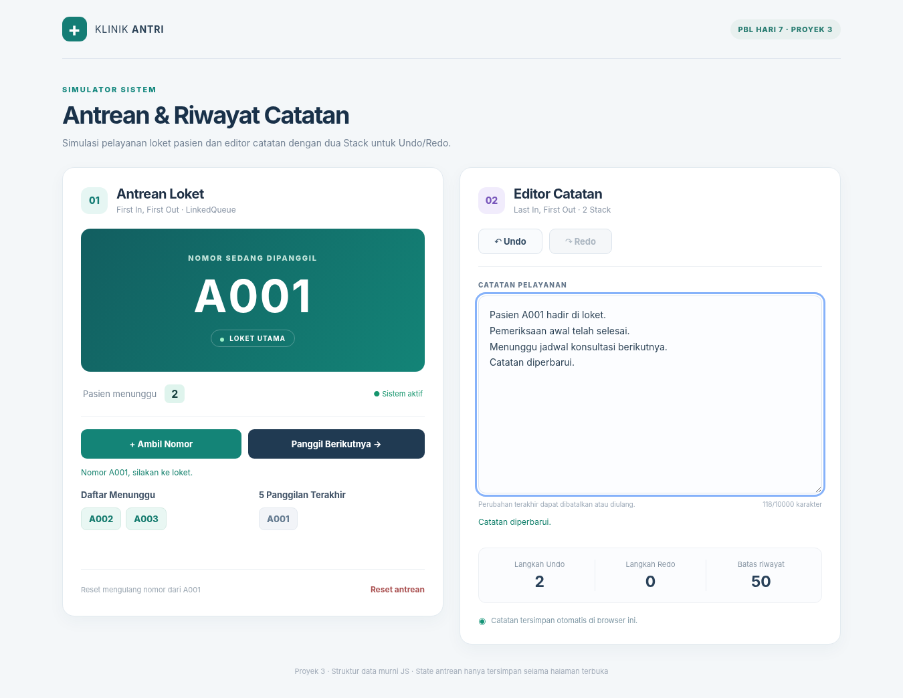
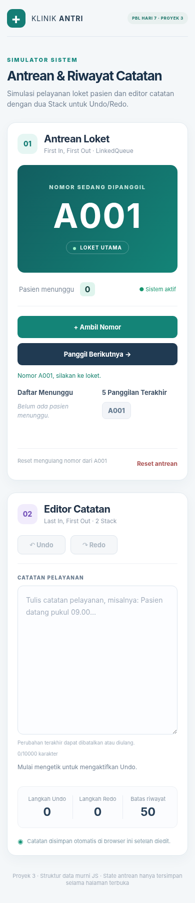

# PBL Hari 7 – Proyek 3: Simulator Antrean dan Riwayat

**Studi kasus:** Klinik kecil membutuhkan sistem antrean pasien dan editor catatan dengan riwayat perubahan. Proyek memakai HTML, CSS, dan JavaScript ES Modules, tanpa database/backend. Cocok untuk pemula.

## 1. Hasil tampilan

**Tampilan desktop** (contoh kondisi A001 dipanggil, A002–A003 menunggu, dan catatan telah diisi):



**Tampilan mobile:**



> Tangkapan layar dibuat dari sumber HTML, CSS, dan logika JavaScript proyek yang sama, dalam pratinjau Chromium. Gunakan tangkapan layar Anda sendiri dari Live Server bila instruktur meminta bukti pengerjaan di komputer peserta.

## 2. Struktur folder

```text
proyek-3-antrian/
├── index.html               # Tampilan utama
├── css/
│   └── style.css            # CSS responsif
├── js/
│   ├── structures.js        # Stack, LinkedList, LinkedQueue (tanpa DOM)
│   ├── antrian.js           # Logika antrean dan 5 panggilan terakhir
│   ├── riwayat.js           # Logika Undo/Redo, maksimal 50 langkah
│   └── app.js               # Menghubungkan DOM dengan logika
├── tests/
│   ├── structures.test.js   # Pengujian struktur data
│   ├── antrian.test.js      # Pengujian antrean klinik
│   └── riwayat.test.js      # Pengujian editor
├── screenshots/
│   ├── tampilan-desktop.png
│   └── tampilan-mobile.png
├── scripts/
│   └── buat-standalone.js   # Pembuat demo HTML tunggal
├── demo-standalone.html     # Opsional: bisa dibuka langsung di browser
├── eslint.config.js        # Konfigurasi lint
├── .prettierrc              # Konfigurasi formatting
├── .prettierignore
├── package.json
├── LAPORAN-PBL.md           # Laporan dan hasil pengujian
└── README.md
```

## 3. Panduan menjalankan — pilihan termudah

### Pilihan A: VS Code + Live Server (disarankan untuk tugas)

1. Unduh dan ekstrak ZIP proyek.
2. Buka **VS Code** → **File → Open Folder** → pilih `proyek-3-antrian`.
3. Pastikan file `index.html`, `css/style.css`, dan semua file di folder `js/` tersedia.
4. Instal ekstensi **Live Server** pada VS Code apabila belum ada.
5. Klik kanan `index.html` → **Open with Live Server**.
6. Halaman antrean klinik akan terbuka di browser. Jalankan kasus uji pada bagian 5.
7. Tekan **F12 → Console** untuk memeriksa jika ada kesalahan JavaScript.

### Pilihan B: Buka HTML langsung tanpa server

Buka `demo-standalone.html` (klik dua kali). Versi ini memiliki CSS dan JavaScript yang sudah digabung dalam satu file, sehingga tidak perlu Live Server. **Tetap kumpulkan file proyek modular** sesuai struktur pada soal. Untuk membuat ulang demo setelah mengubah source, jalankan `npm run build:demo`.

### Pilihan C: Node.js untuk pengujian otomatis

Buka **Terminal → New Terminal** di dalam folder proyek:

```bash
node -v
npm test
```

`npm test` **tidak memerlukan `npm install`** karena menggunakan modul pengujian bawaan Node.js. Gunakan Node.js 20 atau lebih baru.

## 4. Panduan mengenal file JavaScript

### `js/structures.js` — struktur data tanpa DOM

- `Stack`: menyimpan snapshot perubahan dengan LIFO (push, pop, peek, clear). Konstruktor menerima batas kapasitas maksimal; saat penuh nilai paling lama dikeluarkan.
- `LinkedList`: node terhubung lewat `next`, menyimpan pointer `#head`, `#tail`, dan jumlah node dalam private fields.
- `LinkedQueue`: memanfaatkan LinkedList (`enqueue` → `addLast`, `dequeue` → `removeFirst`), sehingga keduanya **O(1)**.
- Tidak ada `document`, `window`, atau HTML pada file ini.

### `js/antrian.js` — logika antrean

- `ambilNomor()` menghasilkan `A001`, `A002`, `A003`, ...
- `panggilBerikutnya()` mengeluarkan satu nomor terdepan. Jika kosong, menghasilkan `{berhasil:false, pesan:'Antrean kosong...'}`.
- `getStatus()` menghasilkan snapshot jumlah pasien, daftar menunggu, nomor aktif, dan 5 nomor panggilan terakhir (paling baru lebih dulu).
- `reset()` membersihkan antrean, panggilan terakhir, riwayat, dan mengulang nomor dari `A001`.
- `AWALAN_NOMOR`, `NOMOR_AWAL`, `DIGIT_NOMOR`, dan `MAKS_RIWAYAT_PANGGILAN` adalah konstanta bernama (bukan angka ajaib).

### `js/riwayat.js` — editor dengan dua Stack

- Saat mengetik: simpan teks lama di stack Undo, ubah teks saat ini, kosongkan stack Redo.
- Saat Undo: pindahkan teks saat ini ke stack Redo, lalu ambil teks dari Undo.
- Saat Redo: pindahkan teks saat ini ke stack Undo, lalu ambil teks dari Redo.
- Batas riwayat **50 perubahan**, melalui `MAKS_RIWAYAT = 50`.
- Teks maksimum **10.000 karakter** untuk mencegah snapshot terlalu besar.
- Jika tidak ada Undo/Redo, method mengembalikan `false` tanpa error.

### `js/app.js` — penghubung UI

- Menangani tombol, mengubah tampilan antrean, menampilkan pesan, dan menjaga tombol Undo/Redo tetap sesuai kondisi.
- Reset hanya dilakukan jika pengguna menyetujui `window.confirm()`.
- Daftar nomor dibuat menggunakan `createElement()` dan `textContent`, bukan `innerHTML` dari input pengguna.
- `localStorage` **hanya menyimpan isi catatan**. Riwayat Undo/Redo tidak disimpan sehingga akan direset jika halaman dimuat ulang. Antrean juga hanya tersimpan selama halaman aktif.

## 5. Kasus uji wajib (sesuai gambar tugas)

| No | Tindakan | Hasil yang benar |
|---|---|---|
| 1 | Klik **Ambil Nomor** 3 kali | Daftar `A001`, `A002`, `A003`; jumlah menunggu 3 |
| 2 | Klik **Panggil Berikutnya** 4 kali | Tiga panggilan sukses berurutan, panggilan ke-4 pesan **Antrean kosong** |
| 3 | Mengetik `A`, `AB`, `ABC` dalam 3 perubahan | Penghitung Undo = 3 |
| 4 | Tekan **Undo** 3 kali | Catatan kembali kosong dan Undo menjadi nonaktif |
| 5 | Tekan **Redo** 2 kali | Catatan menjadi `AB` |
| 6 | Undo 1 kali lalu mengetik `AX` | Tombol Redo menjadi nonaktif; redo lama terhapus |
| 7 | Ambil beberapa nomor lalu klik **Reset antrean → Batal** | Antrean tetap ada |
| 8 | Klik **Reset antrean → OK** | Antrean bersih, panggilan aktif hilang, nomor berikutnya A001 |
| 9 | Panggil 7 nomor | Riwayat menyimpan hanya 5 terbaru: A007 sampai A003 |
| 10 | Ketik lebih dari 50 perubahan | Undo dibatasi maksimal 50 langkah |

**Hasil pengujian source:** 29 test otomatis lulus; pengujian interaksi UI di Chromium (dengan pratinjau JS yang digabung dari modul asli) juga berhasil untuk kasus 1–8 dan layout mobile. Pengujian langsung lewat Live Server tetap perlu dilakukan di komputer peserta.

## 6. Kualitas kode — ESLint & Prettier

Untuk memasang alat pengecekan gaya kode (memerlukan akses internet pada saat instalasi):

```bash
npm install
npm run format
npm run lint
npm run format:check
```

Konfigurasi disediakan dalam `eslint.config.js` dan `.prettierrc`. Kode diperiksa menggunakan `node --check` dan unit test. **Catatan jujur:** instalasi paket ESLint/Prettier dan eksekusi keduanya tidak dapat dilakukan di lingkungan pembuatan karena akses ke registry npm sedang tidak tersedia; jalankan empat perintah tersebut di komputer Anda untuk memverifikasi dan memformat final sesuai kebutuhan tugas. `npm run format` secara otomatis merapikan file sesuai konfigurasi Prettier.

## 7. Tabel pemilihan struktur data

| Kebutuhan | Struktur dipilih | Alasan | Alternatif yang tidak dipilih |
|---|---|---|---|
| Antrean pasien | `LinkedQueue` | Enqueue dan dequeue O(1) | Array + `shift()` perlu O(n) saat menggeser data |
| Riwayat Undo/Redo | Dua `Stack` | LIFO, perubahan terakhir dibatalkan dulu | Queue karena FIFO tidak sesuai |
| Riwayat 5 panggilan | Array pendek | Maksimal 5 elemen, mudah ditampilkan | LinkedList terlalu kompleks untuk ukuran sekecil ini |

## 8. Penggunaan dan keamanan

- Aplikasi ini adalah **simulasi pembelajaran**, bukan sistem rekam medis atau antrean produksi.
- **Jangan masukkan nama pasien atau informasi kesehatan nyata.** `localStorage` tidak cocok untuk menyimpan rekam medis sensitif; data tersimpan pada browser dan perangkat yang digunakan.
- Secara sengaja nomor antrean **tidak** disimpan lintas pemuatan ulang halaman. Ini agar tiap sesi latihan dapat diulang dari A001. Catatan tersimpan selama penyimpanan browser tersedia.
- Untuk membangun produk nyata, diperlukan autentikasi, kontrol akses, backend, database, audit log, dan prosedur pengamanan data.

## 9. Checklist pengumpulan

- [ ] `structures.js` memakai private fields dan tanpa DOM.
- [ ] `antrian.js` menggunakan LinkedQueue dan memenuhi fitur antrean.
- [ ] `riwayat.js` menggunakan 2 Stack, maksimal 50 langkah.
- [ ] `app.js` menangani UI tanpa mengubah aturan struktur data.
- [ ] Pengujian kasus wajib dicatat (termasuk antrean kosong dan reset).
- [ ] `npm test` lulus.
- [ ] `npm run format` dan `npm run lint` dijalankan di komputer peserta.
- [ ] Screenshot hasil Anda ditambahkan pada laporan.
- [ ] `LAPORAN-PBL.md` dan README disertakan.
