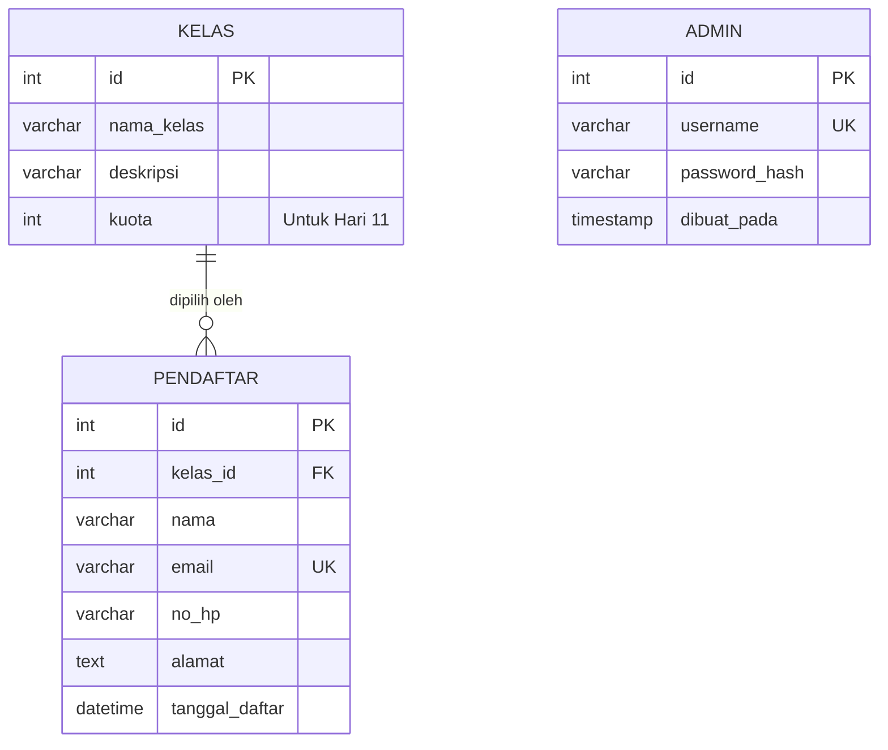

# 03 — Desain Basis Data dan ERD

Nama database: **`db_capstone_sprint0`**. File skema siap impor: `../database/skema.sql`.

## A. Entity Relationship Diagram (ERD)



**Makna:** 1 kelas dapat diikuti banyak pendaftar; setiap pendaftar memilih 1 kelas. Tabel `admin` belum memiliki relasi FK dengan pendaftar karena autentikasi/audit perubahan dijadwalkan Hari 11. Tabel admin tetap dibuat agar desain memenuhi studi kasus, tetapi belum digunakan login.

## B. Kamus data

### Tabel `kelas`
| Field | Tipe | Keterangan |
|---|---|---|
| id | INT PK AUTO_INCREMENT | ID kelas |
| nama_kelas | VARCHAR(100) NOT NULL | Nama kelas |
| deskripsi | VARCHAR(255) NULL | Penjelasan singkat |
| kuota | INT NOT NULL DEFAULT 20 | Kapasitas rencana; **belum divalidasi pada Sprint 0** |

### Tabel `pendaftar`
| Field | Tipe | Keterangan |
|---|---|---|
| id | INT PK AUTO_INCREMENT | ID pendaftar |
| kelas_id | INT FK NOT NULL | Referensi kelas.id |
| nama | VARCHAR(100) NOT NULL | Nama peserta |
| email | VARCHAR(150) UNIQUE NOT NULL | Tidak boleh sama antar pendaftar |
| no_hp | VARCHAR(20) NOT NULL | Nomor HP |
| alamat | TEXT NULL | Alamat opsional |
| tanggal_daftar | DATETIME DEFAULT CURRENT_TIMESTAMP | Waktu daftar |

### Tabel `admin` (persiapan Hari 11)
| Field | Tipe | Keterangan |
|---|---|---|
| id | INT PK AUTO_INCREMENT | ID admin |
| username | VARCHAR(60) UNIQUE NOT NULL | Nama login |
| password_hash | VARCHAR(255) NOT NULL | BUKAN password teks asli |
| dibuat_pada | TIMESTAMP DEFAULT CURRENT_TIMESTAMP | Tanggal akun dibuat |

## C. Aturan integritas
- `PRIMARY KEY` menjamin identitas tiap baris unik.
- `UNIQUE (email)` mencegah duplikasi email, termasuk bila dua permintaan datang bersamaan.
- `FOREIGN KEY (kelas_id)` menghindari pendaftar memilih kelas tidak ada; `ON DELETE RESTRICT` mencegah menghapus kelas yang masih dipakai.
- Tidak ada akun admin default dan tidak ada password contoh di SQL.
- `kuota` sudah tersedia untuk kelanjutan tetapi pembatasan kuota **belum diterapkan**.

## D. Impor dari nol
1. Pastikan database latihan `db_capstone_sprint0` boleh dibuat/direset.
2. phpMyAdmin → Import → pilih `database/skema.sql` → Go.
3. Verifikasi dengan perintah:

```sql
USE db_capstone_sprint0;
SHOW TABLES;
SELECT COUNT(*) AS jumlah_kelas FROM kelas;
SELECT COUNT(*) AS jumlah_pendaftar FROM pendaftar;
SELECT COUNT(*) AS jumlah_admin FROM admin;
```

Hasil awal: **3 kelas, 12 pendaftar, 0 admin**. Angka 12 sengaja dipilih untuk menguji paginasi 10 baris per halaman. **Impor ulang skema akan menghapus data latihan sebelumnya dalam database ini.**

## E. Evolusi database
Pada Hari 10 dibutuhkan mekanisme bukti PDF yang tidak dapat diakses sembarang pengguna; bentuk token/link bukti perlu dirancang sebelum menambah kolom. Pada Hari 11 ditambahkan login, otorisasi admin, dan pemeriksaan kuota secara transaksional. Jangan menampilkan data peserta secara publik selama autentikasi belum ada.
