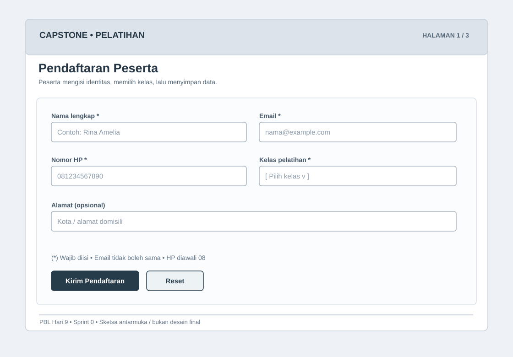
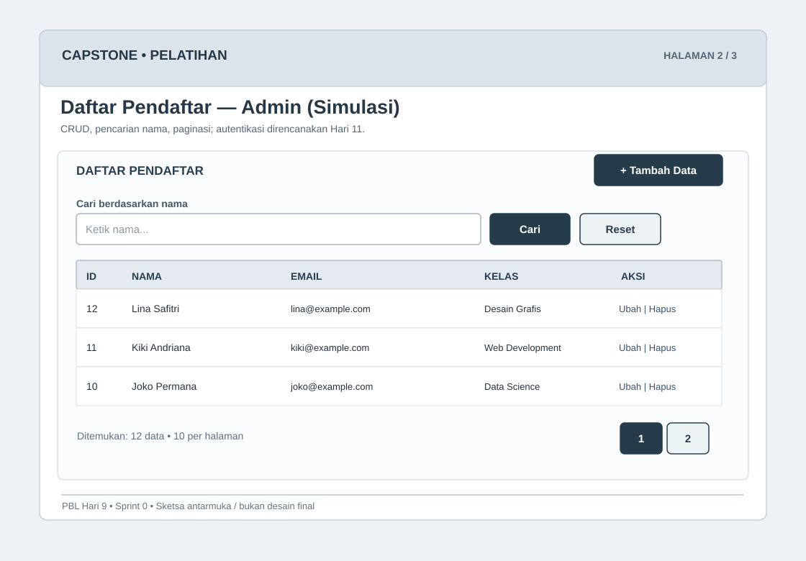
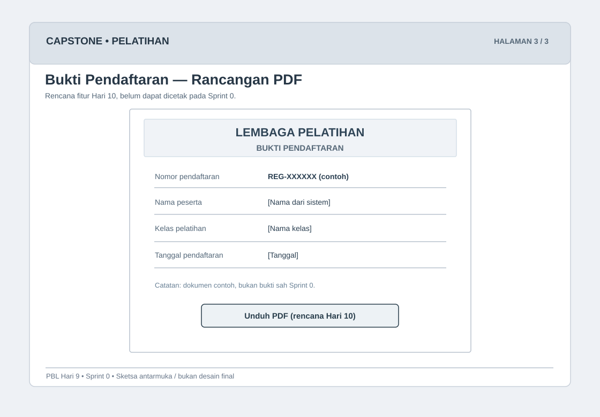

# 04 — Wireframe Tiga Halaman

Wireframe adalah **sketsa tata letak** sebelum antarmuka final. Buka `../wireframes/LIHAT-WIREFRAME.html` melalui browser untuk melihat ketiga diagram besar. File SVG dapat dibuka di browser dan diedit menggunakan editor vektor.

## 1. Form pendaftaran peserta (Sprint 0)

**Komponen:** judul, input nama, email, nomor HP, pilih kelas, alamat (opsional), tombol Kirim Pendaftaran, keterangan wajib dan validasi. Implementasi: `public/daftar.php`. Sesudah berhasil, sistem mengarahkan ke `public/selesai.php`.

## 2. Daftar pendaftar admin (Sprint 0 — simulasi lokal)

**Komponen:** daftar pendaftar, input pencarian, tabel ID/nama/email/kelas/aksi, tombol tambah, tombol ubah-hapus, dan paginasi. Implementasi: `public/index.php`, `public/tambah.php`, `public/ubah.php`, `public/hapus.php`. **Belum ada login/otorisasi**, jadi hanya untuk lingkungan lokal.

## 3. Bukti pendaftaran PDF (rancangan Hari 10)

**Komponen rencana:** kop lembaga, nomor pendaftaran, nama, kelas, tanggal daftar, tombol unduh PDF. **Belum diimplementasikan di Sprint 0**; ilustrasi tidak mewakili bukti pendaftaran resmi yang sudah dapat diunduh. Desain perlu dilengkapi mekanisme identifikasi/token yang tidak dapat ditebak sebelum diterapkan.

## Catatan presentasi
Jelaskan bahwa wireframe ≠ halaman jadi. Saat mendemokan Sprint 0, tampilkan halaman 1 dan 2 yang berfungsi; tunjukkan wireframe halaman 3 sebagai persiapan Sprint berikutnya.
