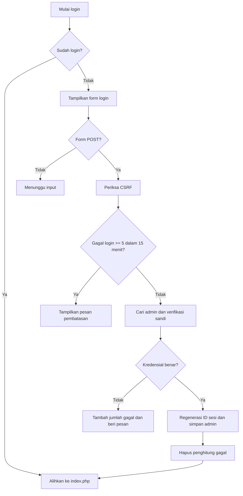
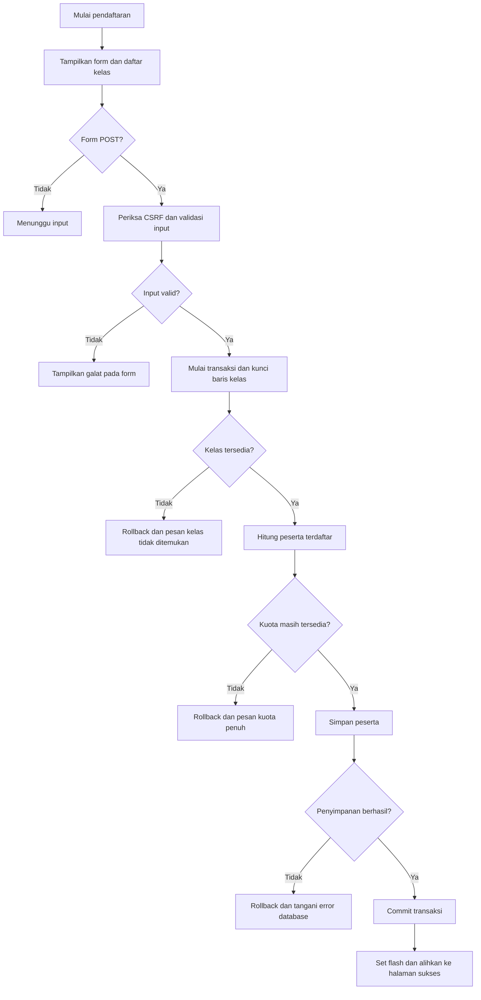

# LAB 1 — IDENTIFIKASI KODE DAN KOMENTAR
## Peta Modul Aplikasi Pendaftaran

**Nama dokumen:** `docs/peta-modul.md`  
**Sumber analisis:** arsip `src.rar` dan `public.rar` yang diberikan untuk tugas ini  
**Ruang lingkup:** semua berkas di `src/` dan `public/`, termasuk `public/assets/js/`  
**Hasil inventarisasi:** 7 berkas pada `src/`, 10 berkas pada `public/`, **17 berkas seluruhnya**, **30 fungsi PHP tingkat global**, serta 2 kelas exception khusus.

> **Cara membaca:** Fungsi *publik* dalam aplikasi ini berarti fungsi PHP tingkat global (bukan metode `public` di dalam class). Berkas halaman di `public/` adalah endpoint yang menjalankan instruksi saat diakses; berkas tersebut tidak mendefinisikan fungsi PHP global baru. `app.js` berisi callback dan fungsi lokal, bukan API publik yang diekspor.

---

## 1. Tabel berkas, tanggung jawab, dan daftar fungsi publik

### 1.1 Folder `src/` (logika aplikasi)

| No. | Berkas | Tanggung jawab / isi utama | Fungsi publik yang didefinisikan |
|---:|---|---|---|
| 1 | `src/bootstrap.php` | Menyiapkan sesi, zona waktu Asia/Jakarta, membaca konfigurasi, mengatur tampilan/log kesalahan, dan memuat semua modul dengan `require_once`. | **Tidak ada**; berisi kode inisialisasi. |
| 2 | `src/database.php` | Membuat serta menggunakan kembali koneksi MySQL melalui PDO, dan menangani kegagalan koneksi. | `getConnection()` |
| 3 | `src/helpers.php` | Utilitas keamanan dan HTTP: escape HTML, CSRF, pembatasan metode POST, flash message, redirect, pemeriksaan sesi admin, izin cetak, dan validasi ID. | `e()`, `tokenCsrf()`, `cekCsrf()`, `hanyaPost()`, `setFlash()`, `ambilFlash()`, `alihkan()`, `redirect()`, `sudahLogin()`, `bolehCetak()`, `validId()` |
| 4 | `src/auth.php` | Mencari akun admin, memverifikasi kredensial, membentuk sesi setelah login, melindungi halaman admin, dan logout. | `cariAdmin()`, `prosesLogin()`, `wajibLogin()`, `logout()` |
| 5 | `src/validasi.php` | Validasi format nomor HP, perhitungan sisa kuota sederhana, dan format nomor bukti. | `validNoHp()`, `hitungSisaKuota()`, `formatNomorBukti()` |
| 6 | `src/pendaftar.php` | Membaca kelas dan peserta, mencari peserta, validasi lengkap pendaftar, serta operasi tambah/ubah/hapus peserta. | `daftarKelas()`, `ambilSemuaPendaftar()`, `cariPendaftar()`, `ambilBuktiPendaftar()`, `ambilPendaftarById()`, `validasiPendaftar()`, `tambahPendaftar()`, `ubahPendaftar()`, `hapusPendaftar()` |
| 7 | `src/kuota.php` | Menjalankan tambah dan ubah peserta dalam transaksi database dengan penguncian baris kelas (`SELECT ... FOR UPDATE`) agar kuota tidak terlampaui. | `daftarkanDenganKuota()`, `ubahPendaftarDenganKuota()`; juga mendefinisikan kelas `KuotaPenuhException` dan `KelasTidakDitemukanException`. |

**Jumlah fungsi:** 0 + 1 + 11 + 4 + 3 + 9 + 2 = **30 fungsi PHP**.

### 1.2 Folder `public/` (halaman, endpoint, dan JavaScript)

| No. | Berkas | Tanggung jawab / isi utama | Fungsi/modul dari `src/` yang digunakan | Fungsi publik baru? |
|---:|---|---|---|---|
| 1 | `public/index.php` | Halaman daftar peserta khusus admin; pencarian berdasarkan nama/email; tombol tambah, ubah, hapus, dan cetak PDF. | `wajibLogin()`, `ambilSemuaPendaftar()`, `cariPendaftar()`, `getConnection()`, `e()`, `tokenCsrf()` | Tidak ada |
| 2 | `public/login.php` | Form login admin; memeriksa CSRF; membatasi maksimal 5 percobaan gagal per sesi dalam jendela 15 menit; mengarahkan ke dashboard saat berhasil. | `sudahLogin()`, `redirect()`, `cekCsrf()`, `prosesLogin()`, `getConnection()`, `setFlash()`, `e()`, `tokenCsrf()` | Tidak ada |
| 3 | `public/logout.php` | Endpoint logout khusus POST; memeriksa login dan CSRF, menghapus sesi, lalu menuju halaman login. | `wajibLogin()`, `hanyaPost()`, `cekCsrf()`, `logout()`, `redirect()` | Tidak ada |
| 4 | `public/daftar.php` | Form pendaftaran untuk pengunjung tanpa login; memvalidasi input, memeriksa kuota, menyimpan peserta, serta menampilkan kesalahan atau keberhasilan. | `getConnection()`, `daftarKelas()`, `cekCsrf()`, `validasiPendaftar()`, `daftarkanDenganKuota()`, `setFlash()`, `redirect()` | Tidak ada |
| 5 | `public/tambah.php` | Form untuk admin menambahkan peserta; memvalidasi dan menyimpan peserta sesuai kuota. | `wajibLogin()`, `getConnection()`, `daftarKelas()`, `cekCsrf()`, `validasiPendaftar()`, `daftarkanDenganKuota()`, `setFlash()`, `alihkan()` | Tidak ada |
| 6 | `public/ubah.php` | Form untuk admin mengubah peserta; memeriksa ID, memuat data awal, memvalidasi perubahan dan memastikan kuota kelas tujuan. | `wajibLogin()`, `validId()`, `getConnection()`, `ambilPendaftarById()`, `daftarKelas()`, `cekCsrf()`, `validasiPendaftar()`, `ubahPendaftarDenganKuota()`, `setFlash()`, `alihkan()` | Tidak ada |
| 7 | `public/hapus.php` | Endpoint penghapusan peserta khusus admin/POST; memeriksa CSRF, ID, dan konfirmasi, lalu menghapus data. | `wajibLogin()`, `hanyaPost()`, `cekCsrf()`, `validId()`, `getConnection()`, `ambilPendaftarById()`, `hapusPendaftar()`, `setFlash()`, `alihkan()` | Tidak ada |
| 8 | `public/cetak.php` | Mencetak bukti pendaftaran dalam format PDF (Dompdf) untuk admin; memvalidasi ID, mengatur nomor bukti dan template PDF. | `wajibLogin()`, `validId()`, `bolehCetak()`, `ambilBuktiPendaftar()`, `getConnection()`, `formatNomorBukti()` | Tidak ada |
| 9 | `public/sukses.php` | Endpoint pengalih ke `daftar.php?status=sukses`; bukan halaman penyimpan data. | `redirect()` | Tidak ada |
| 10 | `public/assets/js/app.js` | Mengelola notifikasi SweetAlert2, konfirmasi penghapusan, dan inisialisasi tabel DataTables; menyediakan fallback saat library tidak tersedia. | Tidak memanggil fungsi PHP langsung; berinteraksi dengan DOM dan library JavaScript. | **Tidak ada fungsi yang diekspor**; terdapat fungsi panah lokal `kirim` dan callback event. |

**Catatan cakupan:** File dalam folder `config/`, `templates/`, `vendor/`, dan `database/` tidak termasuk inventaris karena tidak ada dalam dua folder arsip yang diminta. Beberapa berkas `public/` mengandalkan `templates/header.php`, `templates/_form.php`, `templates/footer.php`, `templates/bukti.php`, dan/atau `vendor/autoload.php` yang tidak dilampirkan.

### 1.3 Hubungan antarberkas

1. Endpoint `public/*.php` memuat `src/bootstrap.php`.
2. `src/bootstrap.php` memuat konfigurasi serta `helpers.php`, `database.php`, `validasi.php`, `pendaftar.php`, `kuota.php`, dan `auth.php`.
3. `public/login.php` memakai `prosesLogin()` untuk masuk sebagai admin.
4. `public/daftar.php` dan `public/tambah.php` memakai `validasiPendaftar()` lalu `daftarkanDenganKuota()`.
5. `public/ubah.php` memakai `validasiPendaftar()` lalu `ubahPendaftarDenganKuota()`.
6. `public/cetak.php` memakai Dompdf untuk menghasilkan PDF; `public/assets/js/app.js` menangani interaksi pada browser.

---

## 2. Dokumentasi lima fungsi utama (sesuai tabel Lab 1)

| Fungsi | Parameter (tipe, makna, batasan) | Nilai kembalian | Kasus khusus |
|---|---|---|---|
| `validasiPendaftar()` | `array $input`: data `nama`, `email`, `no_hp`, `alamat`, `kelas_id`; `PDO $pdo`: koneksi database; `?int $kecualiId = null`: ID peserta yang dikecualikan ketika memeriksa email duplikat. Batas input: nama 3–150 karakter, email valid dan maksimum 190 byte, nomor HP diawali `08` serta total 10–13 digit, alamat maksimum 1.000 karakter, `kelas_id` bilangan bulat positif dan harus ada dalam daftar kelas. | `array{'data': array, 'galat': array}` (array berisi data yang telah dinormalisasi dan pesan galat per kolom). | `$kecualiId = null` untuk tambah; saat ubah berisi ID peserta sehingga email miliknya sendiri tidak dianggap duplikat. `galat` kosong berarti lolos validasi, **bukan** berarti kuota tersedia. |
| `ambilPendaftarById()` | `PDO $pdo`: koneksi database; `int $id`: ID peserta yang dicari, seharusnya positif; endpoint memvalidasi ID dengan `validId()`. | `?array`: array data dari tabel `pendaftar` atau `null`. | Mengembalikan `null` bila baris dengan ID tersebut tidak ada. Fungsi tidak melakukan pengecekan ID positif sendiri. |
| `daftarkanDenganKuota()` | `PDO $pdo`: koneksi database yang menggunakan transaksi InnoDB; `array $data`: data peserta yang telah divalidasi, wajib memuat `kelas_id` serta kolom untuk `tambahPendaftar()`. | `int`: ID peserta baru hasil `lastInsertId()`. | Kelas tak ditemukan → `KelasTidakDitemukanException`; kuota penuh → `KuotaPenuhException`; kegagalan lain → exception diteruskan. Transaksi di-*rollback* ketika terjadi exception. |
| `prosesLogin()` | `PDO $pdo`: koneksi database; `string $username`: username admin; `string $sandi`: kata sandi yang dikirim pengguna. Pengelolaan sesi disiapkan oleh `bootstrap.php`. | `bool`: `true` jika kredensial benar, `false` bila username tidak ada atau kata sandi salah. | Jika berhasil, ID sesi dibuat ulang dan `$_SESSION['admin_id']`, `admin_username` disimpan; token CSRF lama dihapus. Pembatasan 5 percobaan per sesi/15 menit dilakukan di `public/login.php`, **bukan** di fungsi ini. |
| `ubahPendaftarDenganKuota()` | `PDO $pdo`: koneksi database; `int $id`: ID peserta yang diubah (positif); `array $data`: data hasil validasi, termasuk `kelas_id` tujuan. | `void`: tidak mengembalikan nilai. | Kelas tujuan tak ada → `KelasTidakDitemukanException`; kuota penuh → `KuotaPenuhException`. Perhitungan keterisian mengecualikan `id` peserta yang sedang diubah sehingga tidak menghitungnya dua kali. Error menyebabkan *rollback*. |

### 2.1 Signature fungsi berdasarkan kode asli

```php
// src/pendaftar.php
function validasiPendaftar(array $input, PDO $pdo, ?int $kecualiId = null): array
function ambilPendaftarById(PDO $pdo, int $id): ?array

// src/kuota.php
function daftarkanDenganKuota(PDO $pdo, array $data): int
function ubahPendaftarDenganKuota(PDO $pdo, int $id, array $data): void

// src/auth.php
function prosesLogin(PDO $pdo, string $username, string $sandi): bool
```

### 2.2 Contoh pemanggilan sederhana

```php
$pdo = getConnection();

$hasil = validasiPendaftar($_POST, $pdo); // Tambah: kecualiId memakai null
if ($hasil['galat'] === []) {
    $idBaru = daftarkanDenganKuota($pdo, $hasil['data']);
}

$peserta = ambilPendaftarById($pdo, 1); // array atau null
```

> Contoh di atas untuk mempelajari hubungan fungsi. Pada aplikasi sebenarnya, `daftarkanDenganKuota()` harus dipanggil dalam `try`/`catch`, seperti yang dilakukan di `public/daftar.php`, agar kuota penuh dan kesalahan database ditangani dengan baik.

---

## 3. Tinjauan komentar kode (panduan pengerjaan butir 3)

**Status:** bagian ini adalah **hasil peninjauan dan usulan komentar**, **bukan pernyataan bahwa berkas PHP yang diunggah telah diedit**. Untuk memenuhi tugas sepenuhnya, terapkan komentar yang sesuai pada source code proyek Anda, lalu uji ulang program.

| Lokasi | Hasil peninjauan | Usulan alasan yang perlu dijelaskan |
|---|---|---|
| `src/kuota.php` — sebelum `SELECT ... FOR UPDATE` | Sudah ada komentar mengenai transaksi, tetapi alasan penguncian dapat diperjelas. | Kunci baris kelas mencegah dua transaksi menyimpan peserta secara bersamaan ketika kursi terakhir diperebutkan. |
| `src/kuota.php` — `catch (Throwable $e)` pada kedua fungsi | Sudah melakukan rollback lalu melempar ulang error. | Rollback membatalkan perubahan jika gagal; error dilempar ulang agar endpoint dapat menentukan pesan yang sesuai. |
| `src/auth.php` — `session_regenerate_id(true)` | Ada komentar token CSRF, tetapi alasan pergantian ID sesi belum dijelaskan. | Membuat ID sesi baru setelah autentikasi mengurangi risiko *session fixation*. |
| `public/login.php` — penghitung `gagal_login` | Belum ada komentar mengenai alasan jendela 900 detik. | Lima kegagalan dalam jendela 15 menit per sesi dipakai untuk latihan pembatasan login; ini bukan pembatasan menyeluruh per akun/IP. |
| `src/pendaftar.php` — `AND id <> :id` | Perlu komentar agar pembaca memahami pengecualian ID. | Saat mengubah data, email peserta yang sama tidak boleh dianggap sudah dipakai oleh peserta lain. |
| `public/cetak.php` — komentar sebelum `stream()` | Komentar yang ada sudah relevan. | Output HTML sebelum pengiriman PDF dapat merusak respons PDF. |
| `src/helpers.php` — komentar `Sprint 2` pada `bolehCetak()` | Referensi sprint dapat menjadi usang ketika aplikasi berkembang. | Sebaiknya komentar menjelaskan aturan akses saat ini: hanya admin boleh mencetak bukti. |

**Contoh komentar yang dapat ditambahkan di `src/kuota.php`:**

```php
// Baris kelas dikunci sampai transaksi selesai agar dua
// pendaftaran bersamaan tidak sama-sama memakai kursi terakhir.
$stmt = $pdo->prepare('SELECT kuota FROM kelas WHERE id = :id FOR UPDATE');
```

**Contoh komentar yang dapat ditambahkan di `src/auth.php`:**

```php
// Ganti ID sesi setelah login untuk mengurangi risiko session fixation.
session_regenerate_id(true);
```

**Contoh komentar yang dapat ditambahkan di `src/pendaftar.php`:**

```php
// Kecualikan ID peserta yang sedang diedit supaya email miliknya
// sendiri tidak ditandai sebagai duplikat.
$cek = $pdo->prepare('SELECT COUNT(*) FROM pendaftar WHERE email = :email AND id <> :id');
```

### 3.1 Inventaris blok `catch` dari berkas yang diunggah

| Lokasi | Jenis `catch` | Penanganan dalam kode saat ini |
|---|---|---|
| `src/database.php` | `PDOException` | Menulis log dan mengirim status HTTP 503. |
| `src/kuota.php` — tambah | `Throwable` | Rollback jika transaksi masih berjalan, kemudian melempar kembali exception. |
| `src/kuota.php` — ubah | `Throwable` | Rollback jika transaksi masih berjalan, kemudian melempar kembali exception. |
| `public/daftar.php` | `KuotaPenuhException`, `KelasTidakDitemukanException`, `PDOException` | Menampilkan kesalahan kelas atau email; kesalahan database juga dicatat ke log. |
| `public/tambah.php` | `KuotaPenuhException`, `PDOException` | Menampilkan pesan kesalahan atau mencatat kegagalan database. |
| `public/ubah.php` | `KuotaPenuhException`, `PDOException` | Menampilkan pesan kesalahan atau mencatat kegagalan database. |

**Catatan audit:** `public/tambah.php` dan `public/ubah.php` belum menangani `KelasTidakDitemukanException` secara khusus, padahal fungsi pada `src/kuota.php` dapat melemparkannya. Walaupun validasi kelas dilakukan lebih dahulu, kelas masih mungkin berubah/terhapus sebelum transaksi. Ini adalah temuan perbaikan yang bisa dicatat; jangan mengubah kode tanpa menguji alur kesalahan.

---

## 4. Pseudocode dan diagram Mermaid (butir 4 Lab 1)

### 4.1 Pseudocode login admin

```text
MULAI
Buka public/login.php
Jika sudahLogin(): alihkan ke index.php
Tampilkan formulir login
Jika metode POST:
    Periksa token CSRF
    Baca riwayat gagal login dalam sesi
    Jika jendela waktu sudah >= 15 menit: reset penghitung
    Jika penghitung gagal >= 5: tampilkan pesan pembatasan
    Jika belum dibatasi:
        Cari admin berdasarkan username
        Periksa sandi menggunakan password_verify()
        Jika benar:
            Ganti ID sesi, simpan identitas admin
            Hapus penghitung gagal
            Alihkan ke index.php
        Jika salah:
            Tambah penghitung gagal dan tampilkan pesan
SELESAI
```



### 4.2 Pseudocode pendaftaran publik

```text
MULAI
Buka public/daftar.php
Ambil daftar kelas dan tampilkan formulir
Jika metode POST:
    Periksa token CSRF
    Normalisasi dan validasi nama, email, no HP, alamat, kelas
    Jika ada kesalahan: tampilkan pesan per kolom
    Jika tidak ada kesalahan:
        Mulai transaksi database
        Kunci baris kelas yang dipilih
        Jika kelas tidak ada: batalkan transaksi, tampilkan pesan
        Hitung peserta terdaftar di kelas
        Jika kuota penuh: batalkan transaksi, tampilkan pesan
        Jika masih tersedia:
            Simpan peserta
            Commit transaksi
            Tampilkan pemberitahuan sukses
        Jika database gagal: rollback dan tampilkan pesan gagal
SELESAI
```



> Diagram sengaja menampilkan alur utama yang terdapat pada kode. Dalam kasus token CSRF tidak valid, `cekCsrf()` langsung menghentikan permintaan dengan HTTP 403; kejadian ini tidak perlu digambarkan sebagai percabangan tambahan agar diagram tetap mudah dibaca.

---

## 5. Cara menerapkan dokumen pada proyek

1. Buka proyek pada VS Code.
2. Buat folder `docs` di root proyek jika belum ada.
3. Simpan dokumen ini dengan nama persis `docs/peta-modul.md`.
4. Buka file Markdown di VS Code. Klik kanan dan pilih **Open Preview** untuk melihat tabel dan diagram Mermaid (jika didukung oleh renderer/ekstensi Markdown yang digunakan).
5. Terapkan saran komentar pada berkas PHP **tanpa mengubah perilaku program**.
6. Uji halaman login, pendaftaran, tambah, ubah, hapus, dan cetak setelah perubahan.

### Checklist penilaian Lab 1

- [x] Seluruh berkas di `src/` dan `public/` diinventarisasi dari kode yang diberikan.
- [x] Tanggung jawab tiap berkas dijelaskan.
- [x] Semua fungsi PHP global yang didefinisikan di `src/` didata (30 fungsi).
- [x] Fungsi yang dipanggil setiap endpoint `public/` dicatat.
- [x] Lima fungsi memiliki tabel parameter, nilai kembalian, dan kasus khusus.
- [x] Audit awal komentar serta blok `catch` didokumentasikan.
- [x] Pseudocode dan Mermaid login serta pendaftaran disediakan.
- [ ] **Perlu dikerjakan pada source code:** terapkan usulan perbaikan komentar.
- [ ] **Perlu diuji pada aplikasi asli:** jalankan alur utama setelah perbaikan komentar.

**Kesimpulan:** `src/` berisi logika utama (database, validasi, autentikasi, pendaftar, kuota), sedangkan `public/` berisi halaman serta endpoint HTTP yang memanggil logika tersebut. Pemisahan ini memudahkan perawatan, pengujian, dan dokumentasi aplikasi.
