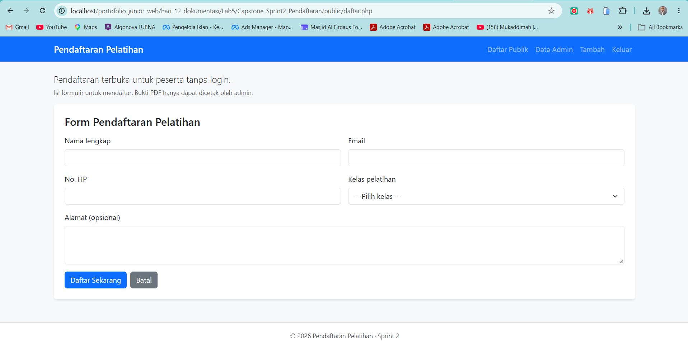
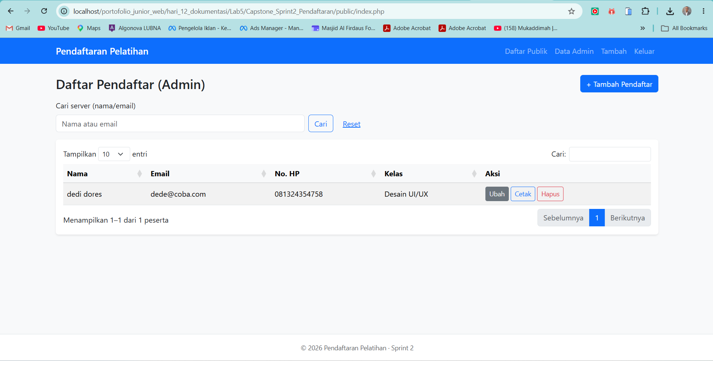
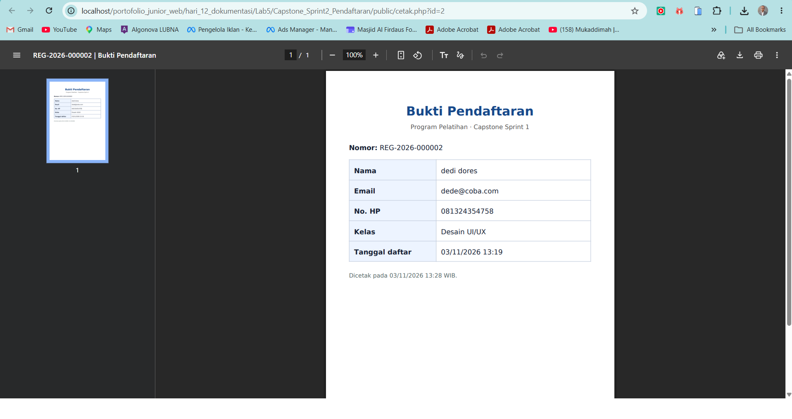

# Panduan Screenshot Asli untuk README Lab 5

Folder ini sengaja **belum berisi screenshot** karena tangkapan layar harus berasal dari aplikasi yang berjalan di komputer Anda. Jangan mengumpulkan gambar simulasi sebagai bukti aplikasi.

## Screenshot 1 — form-pendaftaran.png


1. Jalankan Apache dan MySQL dari XAMPP.
2. Buka `public/daftar.php` melalui URL `http://localhost/...` yang sesuai proyek Anda.
3. Pastikan label form dan tombol **Daftar Sekarang** terlihat; gunakan data fiktif jika mengisi.
4. Tekan `Win + Shift + S`, pilih area aplikasi, simpan sebagai `form-pendaftaran.png` di folder ini.

## Screenshot 2 — panel-admin.png


1. Login ke `public/login.php` menggunakan akun latihan.
2. Buka `public/index.php`; tampilkan tabel peserta dan tombol Tambah/Ubah/Cetak/Hapus.
3. Pastikan hanya data dummy yang tampak; blur/samarkan nama/email/nomor telepon asli.
4. Simpan sebagai `panel-admin.png` di folder ini.

## Screenshot 3 — bukti-pdf.png


1. Saat login sebagai admin, klik **Cetak** pada peserta dummy.
2. Pastikan PDF berhasil terbuka, bukan halaman error.
3. Screenshot tampilan PDF tanpa memperlihatkan identitas nyata.
4. Simpan sebagai `bukti-pdf.png` di folder ini.

## Cara menampilkan di README

Tambahkan Markdown berikut setelah ketiga gambar tersedia:

```markdown


```

Jika Windows menyimpan `.jpg`, jangan hanya mengganti namanya menjadi `.png`; simpan sebagai PNG sungguhan atau ubah tautan README mengikuti ekstensi file aktual.
