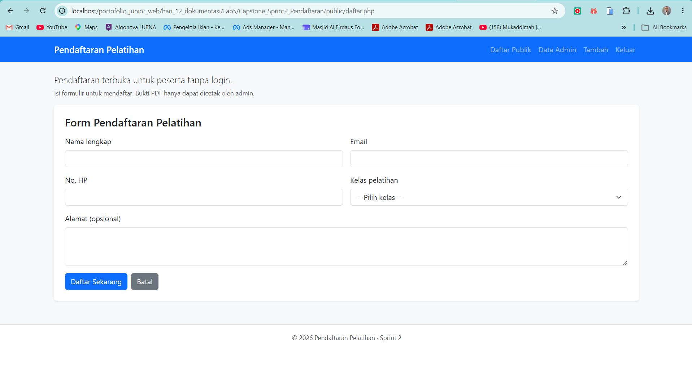
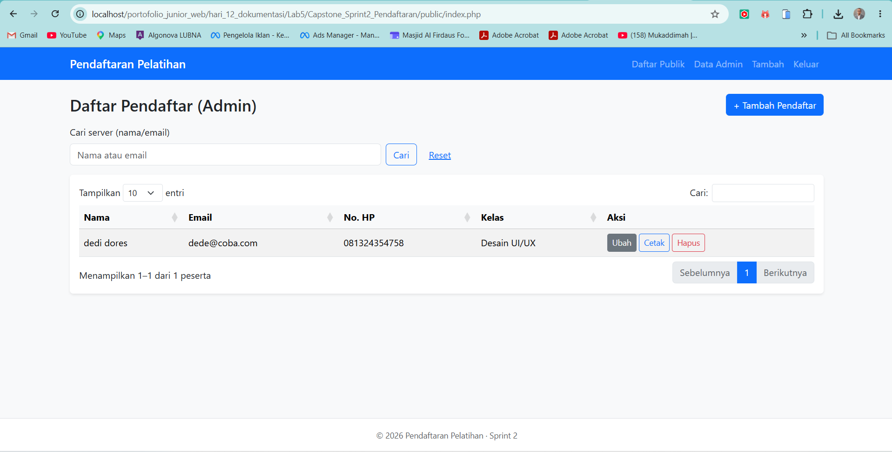
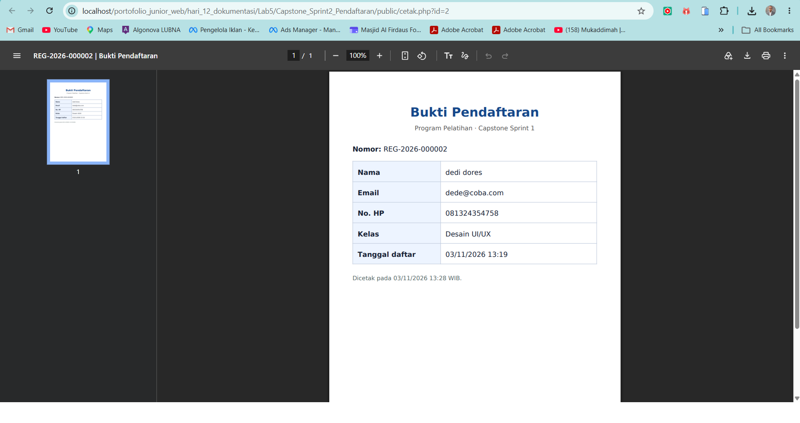

# Capstone Sprint 2 — Sistem Pendaftaran Pelatihan

> Proyek latihan PHP–MySQL untuk pendaftaran peserta, pengelolaan admin, kuota kelas, dan bukti PDF.  
> **Status dokumentasi:** Lab 5 (3 November 2026). **Penulis:** `[Fedy Asfari]`.

## 1. Deskripsi proyek

Aplikasi ini memungkinkan calon peserta mengisi formulir pendaftaran tanpa login. Admin dapat masuk dengan akun yang memiliki *password hash*, mencari dan mengelola data pendaftar, serta mencetak bukti pendaftaran dalam bentuk PDF.

Aplikasi ini adalah **proyek pembelajaran lokal**, bukan aplikasi yang telah diaudit untuk digunakan secara publik/produksi.

## 2. Fitur utama

| Peran | Fitur | Halaman |
|---|---|---|
| Pengunjung | Mengisi formulir dan memilih kelas | `public/daftar.php` |
| Pengunjung | Melihat pemberitahuan pendaftaran berhasil | `public/daftar.php?status=sukses` |
| Admin | Login dengan `password_verify()` dan sesi | `public/login.php` |
| Admin | Daftar peserta, pencarian, serta akses aksi | `public/index.php` |
| Admin | Tambah dan ubah peserta dengan pengecekan kuota | `public/tambah.php`, `public/ubah.php` |
| Admin | Hapus peserta (POST + CSRF + konfirmasi) | `public/hapus.php` |
| Admin | Cetak bukti pendaftaran dalam PDF | `public/cetak.php?id=1` |
| Admin | Logout (POST + CSRF) | `public/logout.php` |

**Aturan penting:** kuota divalidasi ulang dalam transaksi database (`src/kuota.php`); pengisian formulir saja tidak menjamin kursi masih tersedia. Bukti PDF dibatasi untuk admin dalam versi kode ini.

## 3. Teknologi dan persyaratan

- Windows 11, VS Code, XAMPP (Apache + MySQL/MariaDB) untuk praktik lokal.
- PHP **8.1+** dengan PDO MySQL dan `mbstring` (periksa juga ekstensi lain yang dipakai oleh library).
- Composer jika proyek menggunakan `composer.json`; Dompdf dibutuhkan oleh `public/cetak.php` melalui `vendor/autoload.php`.
- JavaScript dan library UI yang dipanggil oleh template proyek (contohnya Bootstrap, SweetAlert2, jQuery/DataTables). Periksa `templates/header.php` dan `templates/footer.php` untuk versi dan metode pemuatan aktual.
- Node.js/npm **hanya untuk kebutuhan dokumentasi JSDoc**; bukan persyaratan utama menjalankan form PHP.

## 4. Struktur folder

```text
Capstone_Sprint2_Pendaftaran/
├── config/
│   ├── config.contoh.php      # contoh aman, jika tersedia
│   └── config.php             # konfigurasi lokal rahasia (jangan di-commit)
├── database/                 # file SQL dan alat admin sesuai proyek Anda
├── docs/
│   ├── gambar/                # screenshot asli dari aplikasi
│   ├── modul/                 # auth.md dan pendaftar.md (Lab 3)
│   ├── api/                   # HTML dari phpDocumentor (Lab 4)
│   ├── api-js/                # HTML dari JSDoc (Lab 4)
│   ├── arsitektur.md          # struktur, alur request, ERD (Lab 5)
│   └── doc-hunt.md            # lembar pemeriksaan dokumentasi (Lab 5)
├── public/                   # endpoint web dan assets/js/app.js
├── src/                      # fungsi PHP, bootstrap, validasi, autentikasi, kuota
├── templates/                # tampilan HTML dan PDF
├── vendor/                   # hasil Composer, jika tersedia
├── README.md
└── CHANGELOG.md
```

**Catatan:** beberapa folder di atas merupakan struktur aplikasi lengkap yang dirujuk oleh kode, bukan semuanya tersedia di paket perubahan Lab 5. Jangan membuat/menimpa folder dependensi atau konfigurasi secara sembarang.

## 5. Instalasi pada Windows + XAMPP

1. **Cadangkan proyek.** Salin proyek Capstone aktif ke folder backup sebelum memasang hasil Lab 5.
2. **Letakkan proyek di `htdocs`.** Contoh: `C:\xampp\htdocs\portofolio_junior_web\hari_12_dokumentasi\Lab5\Capstone_Sprint2_Pendaftaran`. Gunakan lokasi Anda sendiri jika berbeda.
3. **Nyalakan Apache dan MySQL** melalui XAMPP Control Panel; kunjungi `http://localhost/phpmyadmin/`.
4. **Siapkan database.** Cari skema Hari 9, misalnya `database/skema.sql` atau file asli `Skema_PBL_Hari_9.sql`. Impor melalui phpMyAdmin ke **database latihan baru**, lalu periksa tabel `kelas`, `pendaftar`, dan `admin`. **JANGAN impor ulang file yang berisi `DROP TABLE` ke database yang memiliki data penting**; file skema Hari 9 yang ditemukan menggunakan `DROP TABLE`.
5. **Atur konfigurasi lokal.** Jika ada `config/config.contoh.php`, salin menjadi `config/config.php` lalu sesuaikan nama database dan kredensial lokal. Jangan mencantumkan sandi asli di README, screenshot, atau repositori. Jika berkas contoh tidak tersedia, periksa kunci konfigurasi pada `src/database.php` dan buat file konfigurasi lokal sesuai bentuk yang diharapkan `src/bootstrap.php`.
6. **Instal dependensi PDF jika proyek memakai Composer.** Pada terminal di akar proyek, jalankan `composer install` **hanya jika `composer.json` tersedia**. Pastikan `vendor/autoload.php` ada sebelum mencoba fitur Cetak PDF.
7. **Siapkan akun admin** melalui skrip pembuatan admin yang benar-benar tersedia pada proyek Anda (cek folder `database/`). Gunakan hash via `password_hash()`, jangan simpan password sebagai teks biasa dalam SQL/README. Skema Hari 9 **tidak menyediakan akun admin default**.
8. **Buka formulir** sesuai URL proyek lokal, misalnya `http://localhost/portofolio_junior_web/hari_12_dokumentasi/Lab5/Capstone_Sprint2_Pendaftaran/public/daftar.php`. Jika proyek Anda berada di `Lab4` atau folder lain, sesuaikan URL-nya.

**Contoh konfigurasi (hanya ilustrasi, bukan kredensial asli):**

```php
<?php
return [
    'db_host' => '127.0.0.1',
    'db_port' => '3306',
    'db_name' => 'db_capstone_sprint0', // samakan dengan database Anda
    'db_user' => 'ISI_USER_LOKAL',
    'db_password' => 'ISI_PASSWORD_LOKAL',
    'debug' => true,                  // nonaktifkan di produksi
];
```

Simpan contoh aman sebagai `config/config.contoh.php` bila diperlukan; **jangan menimpa konfigurasi yang sudah berfungsi**.

## 6. Cara menjalankan dan memakai aplikasi

1. Buka `public/daftar.php` dari `localhost` untuk mengisi nama, email, nomor HP, alamat, dan kelas.
2. Klik **Daftar Sekarang**. Jika kuota habis, pilih kelas lain; jika valid, aplikasi menampilkan pesan berhasil.
3. Buka `public/login.php` untuk login admin menggunakan akun yang Anda buat, bukan akun default yang diasumsikan.
4. Setelah login, `public/index.php` menampilkan daftar peserta; coba pencarian nama/email, **Tambah**, dan **Ubah**.
5. Klik **Cetak** pada data uji untuk menghasilkan bukti PDF. Fitur ini menggunakan Dompdf dan hanya untuk admin.
6. Uji **Hapus** hanya pada data dummy karena penghapusan permanen.
7. Logout melalui tombol/form aplikasi.

## 7. Screenshot aplikasi — WAJIB diisi menggunakan aplikasi asli

Tugas Lab 5 meminta **tangkapan layar asli** dari proyek yang berjalan. Simpan ketiga file berikut ke `docs/gambar/` (bukan gambar contoh dari internet):

| Tampilan | File yang harus Anda buat | Keterangan |
|---|---|---|
| Formulir pendaftaran | `docs/gambar/form-pendaftaran.png` | Tampak kolom dan tombol daftar; gunakan data dummy |
| Panel admin | `docs/gambar/panel-admin.png` | Tabel peserta dan tombol aksi; samarkan data pribadi |
| Bukti PDF | `docs/gambar/bukti-pdf.png` | Hasil cetak peserta dummy; hindari identitas asli |

**Setelah tiga file PNG tersedia**, tampilkan dalam README dengan menambahkan tiga baris berikut di bawah tabel ini:

```markdown



```

Panduan mengambil gambar: [docs/gambar/README.md](docs/gambar/README.md). Saat paket ini dibuat, screenshot aktual **belum tersedia**, sehingga tidak disisipkan gambar palsu.

## 8. Dokumentasi teknis

- [Arsitektur, struktur folder, alur request, dan ERD](docs/arsitektur.md)
- [Lembar kerja Doc Hunt](docs/doc-hunt.md)
- [Riwayat perubahan](CHANGELOG.md)
- Modul autentikasi: `docs/modul/auth.md` (dari Lab 3).
- Modul pendaftar: `docs/modul/pendaftar.md` (dari Lab 3).
- API PHP: `docs/api/index.html` (hasil phpDocumentor, Lab 4).
- API JavaScript: `docs/api-js/index.html` (hasil JSDoc, Lab 4).

> Folder dokumentasi Lab 3–4 harus sudah ada pada proyek Anda agar semua rujukan di atas dapat dibuka.

## 9. Cara membuat ulang dokumentasi otomatis

**PHP** (jalankan dari akar proyek jika `phpDocumentor.phar` tersedia):

```powershell
& 'C:\xampp\php\php.exe' .\phpDocumentor.phar run -d 'src' -t 'docs/api' --force
```

**JavaScript** (setelah JSDoc terpasang):

```powershell
.\node_modules\.bin\jsdoc.cmd -r .\public\assets\js -d .\docs\api-js
```

Buka `docs/api/index.html` dan `docs/api-js/index.html`. Periksa bahwa fungsi dan deskripsi memang ada, bukan hanya halaman kosong.

## 10. Pengujian dasar

| Skenario | Yang harus diamati |
|---|---|
| Form data valid | Pendaftaran berhasil, record bertambah |
| Email sudah dipakai | Pesan validasi email ganda |
| Kuota kelas penuh | Pendaftaran ditolak dengan pesan aman |
| Salah login | Pesan umum, tanpa bocoran apakah username terdaftar |
| Buka panel admin tanpa login | Diarahkan ke halaman login |
| Hapus tanpa CSRF/POST | Ditolak server |
| Cetak bukti tanpa login | Tidak boleh mengakses PDF |
| Cetak sebagai admin dengan Dompdf tersedia | PDF dapat dibuka |

Gunakan **data fiktif**. Hasil aktual perlu Anda jalankan sendiri dan direkam bila diminta instruktur.

## 11. Keamanan dan keterbatasan

- Password disimpan dalam bentuk hash; form login menggunakan verifikasi hash.
- Pengelolaan data admin menggunakan sesi; beberapa operasi menggunakan token CSRF.
- Output HTML di-escape; query data menggunakan prepared statements pada bagian yang memerlukan input.
- Pembatasan percobaan login pada kode contoh berbasis **sesi**, bukan pengamanan terpusat per IP atau akun.
- Jangan publikasi `config/config.php`, log yang berisi data sensitif, data peserta nyata, atau kredensial.
- Pastikan definisi tabel database Sprint 2 Anda sesuai dengan validasi aplikasi; ERD di dokumen arsitektur merujuk skema Hari 9.

## 12. Bantuan pemecahan masalah

| Gejala | Pemeriksaan |
|---|---|
| HTTP 503 / konfigurasi belum tersedia | Periksa `config/config.php` dan nama database |
| Database tidak dapat diakses | Periksa MySQL XAMPP, PDO MySQL, user/password lokal |
| PDF tidak tercetak | Jalankan Composer jika ada `composer.json`, cek `vendor/autoload.php` |
| Login selalu gagal | Periksa akun admin ada, password hash valid, dan sesi aktif |
| Kuota penuh | Periksa data kelas dan jumlah pendaftar di database |
| JS konfirmasi atau tabel tidak aktif | Periksa `app.js` dan library UI pada template/footer |
| API dokumentasi kosong | Jalankan ulang generator, periksa log parsing dan path `src` |

---

**Catatan Lab 5:** dokumentasi ini dibuat berdasarkan kode `src/`, `public/`, dan skema Hari 9 yang tersedia. Setelah menyalin ke proyek aktif, periksa kembali kesesuaian dengan konfigurasi, template, dan basis data sebenarnya. Tidak ada password asli yang dicantumkan.

## 13. Tambahan finalisasi PBL Hari 12 (belum dinyatakan rilis)

> Bagian ini ditambahkan sebagai **paket perubahan**. Masukkan file baru ke proyek Lab 5 Anda terlebih dahulu, lalu periksa di browser sebelum menandainya selesai.

- Dashboard ringkasan admin: `public/ringkasan.php` (memerlukan `src/struktur_data.php`).
- Kelola kelas (CRUD tambah/ubah/hapus kelas kosong): `public/kelas.php` (fitur tambahan, wajib uji).
- Filter kelas DataTables: panduan perubahan kecil di `docs/filter-kelas-datatables.md`; tidak otomatis terpasang hingga disisipkan pada `index.php` dan `app.js`.
- Struktur data yang dipakai: `SplQueue` untuk 5 pendaftar terbaru dan array asosiatif + `usort()` untuk peringkat kelas; alasan pemilihan tercantum pada `docs/arsitektur.md` bagian 9.
- Unit test non-database: `tests/jalankan.php`.
- Matriks pengujian manual: `docs/kasus-uji.md`.
- Pelaporan temuan: `docs/laporan-bug.md`.
- Daftar pustaka tool/library: `docs/daftar-library.md`.
- Instalasi dari nol (T8): `docs/panduan-instalasi.md`.
- Petunjuk pemakaian: `docs/panduan-pengguna.md`.
- Checklist keamanan dan rilis: `docs/cek-keamanan-dan-rilis.md`.

### Menjalankan pengujian unit

```powershell
& 'C:\xampp\php\php.exe' .\tests\jalankan.php
```

**Batas pengujian:** unit test tersebut tidak memerlukan koneksi database. Jalankan pula kasus manual di `docs/kasus-uji.md` untuk login, CRUD, kuota, DataTables, PDF, CSRF, dan instalasi bersih.

### Bukti screenshot

Setelah Anda mengambil screenshot asli (bukan gambar contoh), tampilkan dengan:

```markdown


```

Untuk tahap rilis, penomoran `v1.0.0` mengacu pada **rilis kode aplikasi yang akan dibuat**, sedangkan nomor `1.0.1` dalam dokumen Lab 3 merupakan versi **dokumentasi modul**. Jangan membuat tag sebelum tes dan audit selesai.

- Bukti instalasi tools (isi setelah praktik): `docs/bukti-instalasi-tools.md`.
- Panduan patch filter kelas: `docs/filter-kelas-datatables.md`.