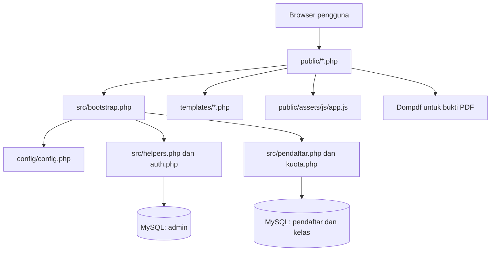
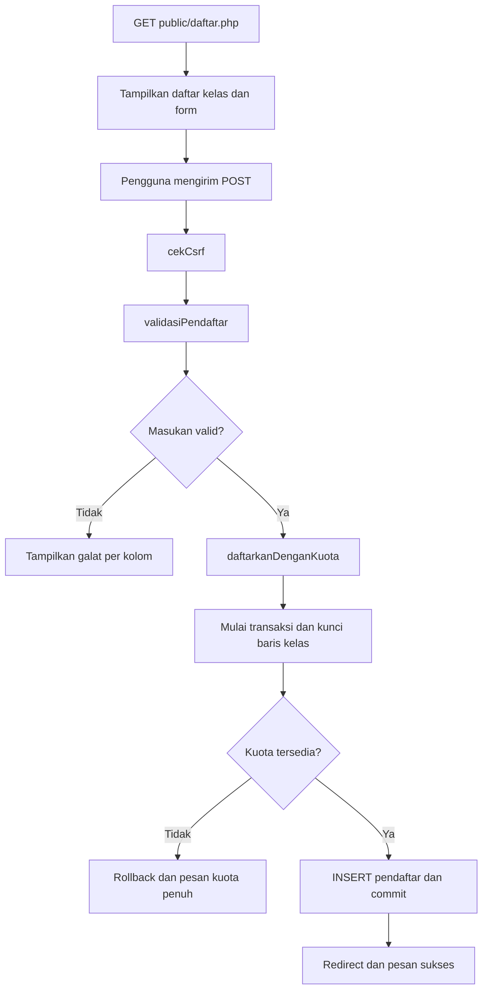
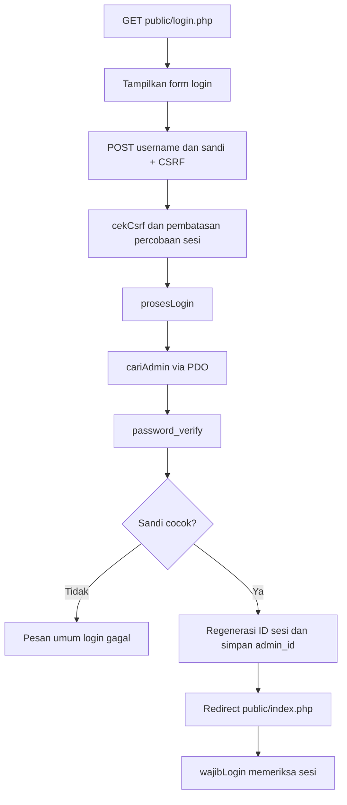
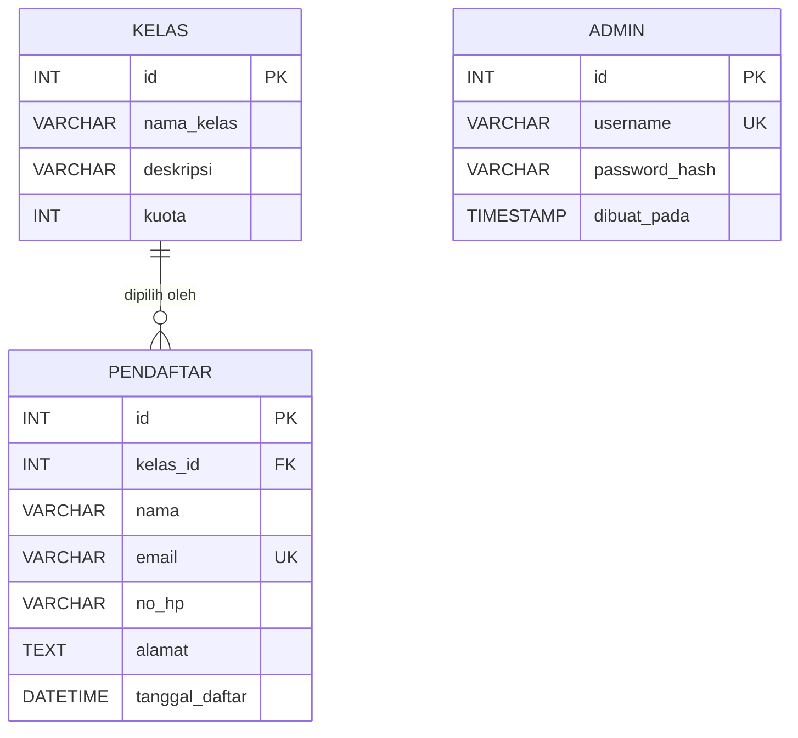
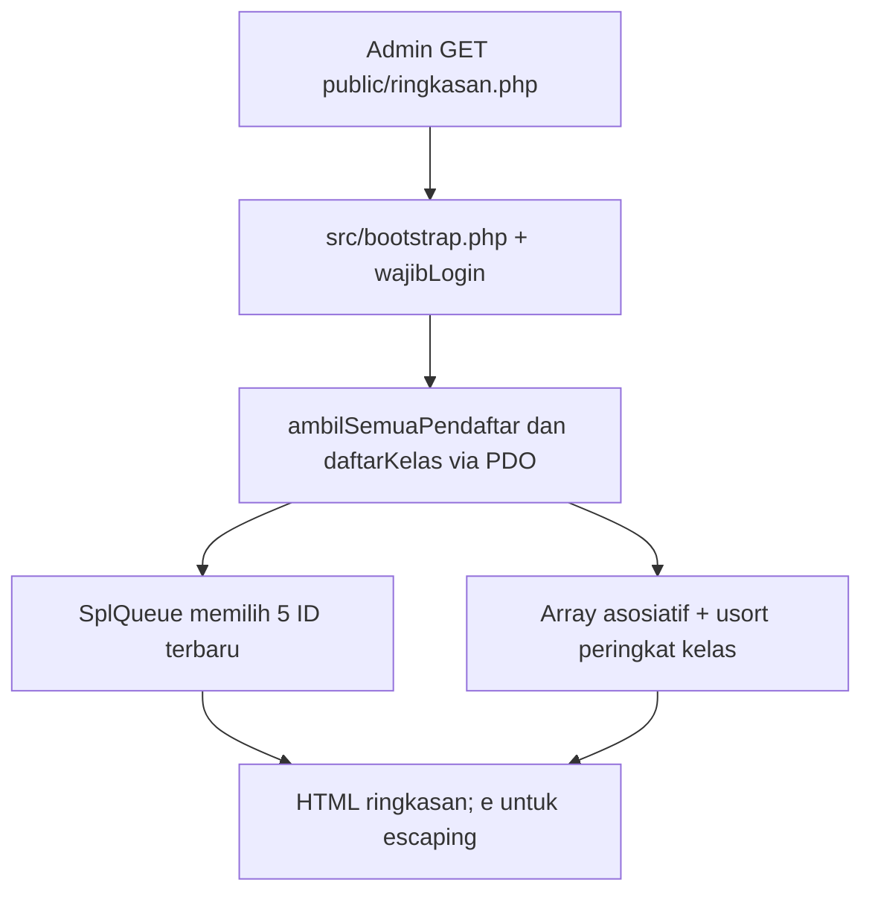

# Arsitektur Aplikasi — Capstone Sprint 2 Pendaftaran

**Tanggal:** 3 November 2026  
**Sumber:** kode `src/`, `public/` yang diunggah untuk Lab 1–2, serta struktur tabel dari skema PBL Hari 9.  
**Penulis:** `[ISI NAMA ANDA]`

## 1. Gambaran umum

Aplikasi menggunakan arsitektur PHP sederhana berbasis request/response. Browser mengakses halaman pada `public/`; tiap halaman memuat `src/bootstrap.php`, yang menyiapkan sesi, konfigurasi, serta fungsi dari `src/` untuk validasi, autentikasi, akses data, dan pengendalian kuota. Tampilan HTML sebagian disimpan pada `templates/`; bukti PDF dibuat dengan Dompdf.



## 2. Struktur folder dan tanggung jawab

| Lokasi | Tanggung jawab | Contoh |
|---|---|---|
| `public/` | Pintu masuk permintaan HTTP | `daftar.php`, `login.php`, `index.php`, `cetak.php` |
| `public/assets/js/` | Perilaku antarmuka web | `app.js` |
| `src/bootstrap.php` | Memulai sesi, memuat config dan modul | `require_once` pada tiap halaman |
| `src/auth.php` | Autentikasi akun dan sesi admin | `prosesLogin`, `wajibLogin`, `logout` |
| `src/pendaftar.php` | CRUD, pencarian, validasi pendaftar, daftar kelas | `validasiPendaftar`, `tambahPendaftar` |
| `src/kuota.php` | Transaksi penambahan/perubahan dengan pembatasan kuota | `daftarkanDenganKuota`, `ubahPendaftarDenganKuota` |
| `src/database.php` | Koneksi PDO | `getConnection` |
| `src/helpers.php` | CSRF, escape HTML, pesan flash, redirect | `tokenCsrf`, `cekCsrf`, `e` |
| `src/validasi.php` | Fungsi validasi dan format kecil | `validNoHp`, `formatNomorBukti` |
| `config/` | Konfigurasi database lokal, bersifat rahasia | `config.php` |
| `database/` | Skema dan alat administrasi database | isi perlu diverifikasi di proyek aktif |
| `templates/` | Template HTML/PDF | `header.php`, `_form.php`, `bukti.php` |
| `docs/` | Peta modul, API otomatis, modul, bukti praktik | `modul/`, `api/`, `api-js/`, `gambar/` |

## 3. Alur request formulir pendaftaran



**Penjelasan pemula:** Request `GET` menampilkan form; request `POST` mengirim data. Token CSRF diperiksa sebelum validasi. Perhitungan kuota harus dilakukan ulang dengan transaksi di server, bukan hanya percaya pada pilihan form. Kesalahan disampaikan dengan pesan aman.

## 4. Alur request login admin



## 5. Alur request bukti PDF

1. Admin login dan membuka `public/index.php`.
2. Tombol Cetak membuka `public/cetak.php?id=...`.
3. Endpoint memanggil `wajibLogin()` dan validasi ID/hak cetak.
4. Data peserta diambil melalui `ambilBuktiPendaftar()`.
5. `templates/bukti.php` dirender, lalu Dompdf menghasilkan PDF A5.

**Catatan:** versi kode yang diperiksa membatasi pencetakan kepada admin, bukan pengunjung umum.

## 6. ERD — mengacu pada skema Hari 9



**Keterangan relasi:** satu kelas dapat diikuti banyak peserta, setiap peserta memiliki satu `kelas_id`. Tabel `admin` tidak memiliki foreign key ke peserta dalam skema Hari 9. `UK` berarti nilai unik; `PK` kunci primer dan `FK` kunci asing.

### Kamus data penting dari skema Hari 9

| Tabel | Kolom utama dan tipe | Aturan penting |
|---|---|---|
| `kelas` | `id INT`, `nama_kelas VARCHAR(100)`, `deskripsi VARCHAR(255)`, `kuota INT` | `id` PK; kuota default 20 pada skema Hari 9 |
| `pendaftar` | `id INT`, `kelas_id INT`, `nama VARCHAR(100)`, `email VARCHAR(150)`, `no_hp VARCHAR(20)`, `alamat TEXT`, `tanggal_daftar DATETIME` | email unik, FK `kelas_id` ke `kelas.id` |
| `admin` | `id INT`, `username VARCHAR(60)`, `password_hash VARCHAR(255)`, `dibuat_pada TIMESTAMP` | username unik, sandi disimpan dalam hash |

### Hal yang harus Anda verifikasi di database aktif

Skema Hari 9 yang ditemukan menggunakan `nama VARCHAR(100)` dan `email VARCHAR(150)`. Sementara itu, validasi kode PHP pada proyek yang diperiksa membatasi nama sampai **150 karakter** dan email sampai **190 karakter**. Jika database Anda masih menggunakan skema Hari 9, ukuran kolom dan validasi tersebut berpotensi berbeda. **Jangan langsung mengubah database**; periksa struktur aktual terlebih dahulu di phpMyAdmin atau jalankan:

```sql
SHOW CREATE TABLE pendaftar;
SHOW CREATE TABLE kelas;
SHOW CREATE TABLE admin;
```

Jika kolom sudah diperbesar pada Sprint 2, gunakan skema aktual Sprint 2 untuk versi akhir ERD. Catat perubahan tersebut dalam `CHANGELOG.md`. SQL Hari 9 yang ditemukan juga memiliki `DROP TABLE`; **jangan jalankan ulang pada database yang berisi data penting**.

## 7. Catatan keamanan

- Browser tidak berinteraksi langsung dengan MySQL; permintaan melalui PHP dan PDO.
- Server memeriksa CSRF untuk formulir mutasi dan akses admin untuk halaman terproteksi.
- Password dicek dengan hash; jangan menyimpan password asli dalam file dokumentasi.
- Hasil pencarian SQL menggunakan parameter terikat; tampilan HTML menggunakan escape pada data yang disisipkan.
- Proyek ini bukan sistem produksi yang telah melewati audit keamanan.

## 8. Rujukan dokumentasi proyek

- `docs/peta-modul.md` — peta fungsi dari Lab 1.
- `docs/modul/auth.md` dan `docs/modul/pendaftar.md` — detail modul Lab 3.
- `docs/api/index.html` dan `docs/api-js/index.html` — hasil generator Lab 4.

## 9. Struktur data tambahan untuk finalisasi PBL Hari 12

**Penerapan nyata:** halaman admin baru `public/ringkasan.php` memuat `src/struktur_data.php` setelah `src/bootstrap.php`; halaman hanya dapat dibuka setelah `wajibLogin()`.

| Struktur/algoritma | Implementasi | Alasan memilih | Konsekuensi |
|---|---|---|---|
| `SplQueue` (FIFO) | `limaPendaftarTerbaru()` mengambil paling banyak 5 pendaftar ber-ID terbaru | Antrean menyimpan jendela 5 data terakhir, lalu membuang data tertua (`dequeue`) ketika data baru masuk | Input diurut berdasarkan ID agar urutannya pasti; ID dianggap indikator urutan pendaftaran, bukan timestamp pasti |
| Array asosiatif + `usort()` | `peringkatKelasBerdasarkanJumlah()` mengurut seluruh kelas menurut `terisi` paling banyak | Data tiap kelas adalah pasangan `nama_kelas` dan `terisi`; hasil mudah ditampilkan sebagai peringkat | Menggunakan `daftarKelas()` sehingga kelas dengan nol peserta tetap terlihat |

**Perhatian:** `SplStack` untuk 10 aktivitas admin *tidak* dipasang karena proyek yang diperiksa belum mempunyai tabel audit aktivitas admin. Menampilkan daftar pendaftar sebagai “aktivitas admin” akan menyesatkan. Jika audit trail kemudian dibuat secara benar, baru pertimbangkan stack di tampilan. Minimal satu struktur data sudah dipenuhi oleh `SplQueue` yang benar-benar digunakan halaman baru.

### Alur request ringkasan



Untuk pengujian unit yang aman tanpa database, jalankan `tests/jalankan.php`. Data riil dan tampilan di browser tetap harus diuji pada komputer pengguna.